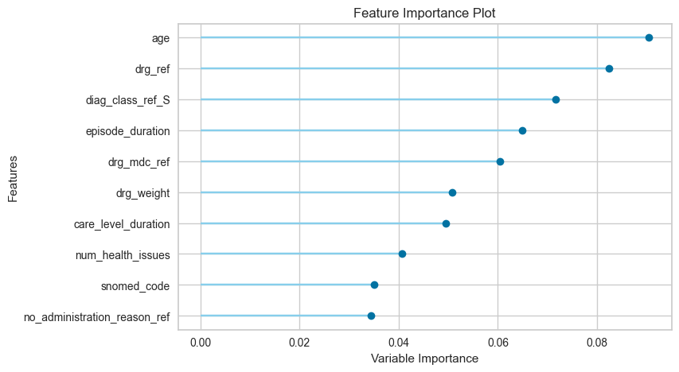

# Predicting Hospital Discharge Diagnoses with Machine Learning and SNOMED CT

Machine learning pipeline that predicts the ICD-10-CM discharge diagnosis of a hospital episode from health problems coded in SNOMED CT at admission, using real Electronic Health Record data from Hospital Clínic de Barcelona.  

Bachelor's thesis in Biomedical Engineering, Universitat de Barcelona (June 2025), carried out with the Clinical Informatics Department of Hospital Clínic de Barcelona.

## Overview

Discharge diagnoses are traditionally coded by hand after the patient leaves the hospital, which can delay billing, reporting and care planning. Hospital Clínic now records a structured list of health problems in SNOMED CT from the start of the hospitalization, which makes early prediction possible.

This project asks whether those early SNOMED CT health problems, combined with demographic, laboratory, prescription and admission data, can predict the final diagnosis. The task is a 20-class classification problem, where the classes are ICD-10-CM chapters. Only diagnoses that were not present on admission are used as targets.

## Results

Seven feature subsets were built with two feature selection methods, and the best of several supervised models was selected and tuned for each. The table shows the performance on the held-out test set.

| Subset | Features | Best model | Accuracy | F1 | AUC |
|--------|----------|------------|----------|----|-----|
| S1 | All 134 features | Decision Tree | 0.6895  | 0.6896 | 0.8303  |
| S2 | Top 20, tree-based importance | Decision Tree | 0.6875 | 0.6878  | 0.8320  |
| S3 | Top 10, tree-based importance | XGBoost | 0.2879 | 0.2834 | 0.8398  |
| S4 | Top 20, ANOVA F-test | Decision Tree | 0.4453 | 0.4444  | 0.9056 |
| S5 | Top 10, ANOVA F-test | Random Forest | 0.4032 | 0.3991 | 0.8985 |
| S6 | Features in both top-20 lists (11) | Decision Tree | 0.4446  | 0.4437 | 0.9054  |
| S7 | Union of both top-20 lists (29) | Decision Tree | 0.6889  | 0.6891 | 0.8327  |

Key findings:

- The best models reach about 69% accuracy on a 20-class problem.
- No single variable dominates. Age, DRG, episode duration, laboratory values and drug dose rank highest, and the SNOMED CT code adds information when combined with them.
- Subsets S4 to S6 show high AUC but low accuracy, which points to class imbalance and a classification threshold that is not well calibrated.




## Data

The data used in this study was obtained from the Hospital Clínic de Barcelona. All information
originates from the hospital’s institutional data warehouse, which serves as a centralized repository for clinical data.  
  
The data is not included in this repository, see [`data/README.md`](data/README.md) for the file descriptions.

## Methods

1. **Data preprocessing:** duplicate removal, handling of missing values, feature creation (age at admission, episode and care-level duration), merging of the 15 sources, and grouping of ICD-10-CM codes into 20 chapters.
2. **Feature selection:** tree-based importance (Extra Trees, 100 trees) and the ANOVA F-test, used to build seven feature subsets.
3. **Model selection:** Logistic Regression, SVM, Decision Tree, Random Forest, XGBoost, KNN and MLP compared per subset with PyCaret, using stratified 10-fold cross-validation on a 70/30 train-test split.
4. **Hyperparameter tuning:** randomized search, with grid search.
5. **Evaluation:** accuracy, recall, precision, F1, AUC, Cohen's kappa and MCC, plus confusion matrices and feature importance plots.

The full methodology, results and discussion are in [`docs/bachelor_thesis.pdf`](docs/bachelor_thesis.pdf).

## Repository structure

```
.
├── data/                 
├── docs/
│   └── bachelor_thesis.pdf
├── notebooks/
│   ├── 01_data_understanding_eda.ipynb
│   ├── 02_data_preprocessing.ipynb
│   ├── 03_feature_selection.ipynb
│   └── models/
│       ├── S1_model.ipynb ... S7_model.ipynb
│       └── images/  # Performance plots for each subset (S1 to S7)
├── README.md
└── requirements.txt
```

Each `SX_model.ipynb` notebook covers model selection, training, evaluation, tuning and testing for one feature subset.

## How to run

```bash
git clone https://github.com/cindychenqiu/discharge-diagnosis-prediction.git
cd discharge-diagnosis-prediction
python -m venv .venv
source .venv\Scripts\activate # on macOS/Linux .venv/bin/activate   
pip install -r requirements.txt
jupyter notebook
```

Tested with Python 3.11. Run the notebooks in this order: `01`, `02`, `03`, then any of the `models/SX_model.ipynb` notebooks.

## Limitations and next steps

- **Class imbalance:** some diagnostic chapters are far more frequent than others, which biases the models toward the majority classes. Resampling (SMOTE), class weights and threshold calibration are the next steps.
- **Inconsistent SNOMED CT coding:** clinicians did not record health problems in SNOMED CT consistently, which limits the value of that variable.
- **Computational limits:** the size of the dataset restricted the extent of the hyperparameter search.
- **Interpretability and language models:** explainability tools such as SHAP and LIME would make the models easier to use in clinical practice, and large language models could help map SNOMED CT concepts to ICD-10 codes.

## Author and acknowledgements

Cindy Chen, [LinkedIn](https://www.linkedin.com/in/cindychenqiu/) | [GitHub](https://github.com/cindychenqiu)

Supervised by Santiago Frid and Juan Barrios, Clinical Informatics Department, Hospital Clínic de Barcelona, and Universitat de Barcelona.